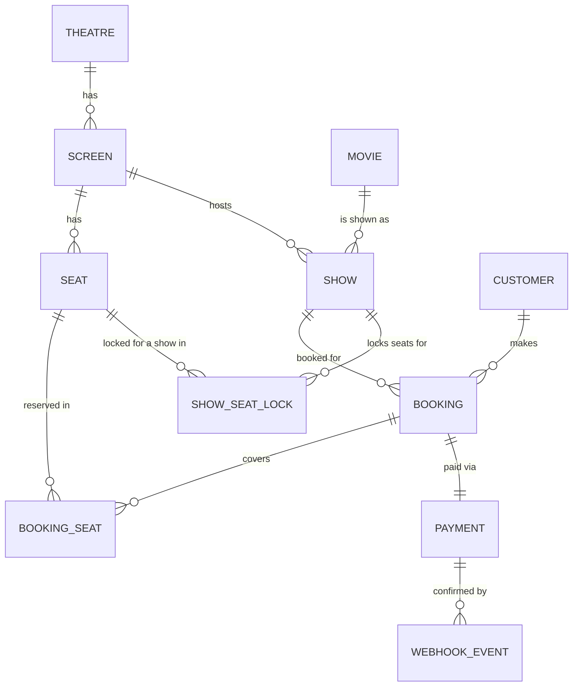

# High-Concurrency Booking Engine

A BookMyShow-style ticketing backend (Java 17, Spring Boot 3, MySQL 8, Redis) where
seat-level locking prevents double-booking, holds auto-release on a timer, and
payment webhooks are processed idempotently through a Redis Streams queue.

> **Submission doc**: [`High-Concurrency-Booking-Engine-Submission.pdf`](High-Concurrency-Booking-Engine-Submission.pdf)
> has the P1/P2 deliverable in one file — all tables with attributes, example
> rows, and the executable SQL.

## Contents
- [Entities & schema (P1)](#entities--schema-p1)
- [Sample data](#sample-data)
- [P2: shows by theatre + date](#p2-shows-by-theatre--date)
- [Concurrency & locking strategy](#concurrency--locking-strategy)
- [Idempotent payment webhooks](#idempotent-payment-webhooks)
- [Burst handling with queues](#burst-handling-with-queues)
- [Running locally](#running-locally)
- [Load testing](#load-testing)

## Entities & schema (P1)



| Table | Key attributes |
|---|---|
| `theatre` | `theatre_id` PK, name, city, address |
| `screen` | `screen_id` PK, `theatre_id` FK, name, total_seats — UNIQUE(theatre_id, name) |
| `movie` | `movie_id` PK, title, language, duration_minutes, genre, release_date |
| `show` | `show_id` PK, `movie_id` FK, `screen_id` FK, show_date, start_time, end_time — UNIQUE(screen_id, show_date, start_time) |
| `seat` | `seat_id` PK, `screen_id` FK, row_label, seat_number, seat_type, price — UNIQUE(screen_id, row_label, seat_number) |
| `customer` | `customer_id` PK, name, email (UNIQUE), phone |
| `booking` | `booking_id` PK, `show_id` FK, `customer_id` FK, status, total_amount, created_at, expires_at |
| `booking_seat` | (`booking_id`, `seat_id`) PK, price_at_booking — historical audit of a booking's seats |
| `show_seat_lock` | (`show_id`, `seat_id`) PK, `booking_id` FK, status, expires_at — **the concurrency-safety table** |
| `payment` | `payment_id` PK, `booking_id` FK (UNIQUE), amount, gateway_reference (UNIQUE), status |
| `webhook_event` | `event_id` PK (from gateway), `payment_id` FK, payload, received_at, processed_at — **idempotency guard** |

Full DDL: [`V1__init_schema.sql`](src/main/resources/db/migration/V1__init_schema.sql).
Directly executable on MySQL 8 (verified locally with `mysql < V1__init_schema.sql`).

### Normalization
- **1NF**: every column holds a single atomic value; no repeating groups.
- **2NF**: composite-key tables (`booking_seat`, `show_seat_lock`) have non-key
  attributes that depend on the *whole* key, not just part of it.
- **3NF / BCNF**: `customer`, `movie`, `theatre` are split into their own tables
  so `booking`/`show` don't carry transitive attributes (e.g. a customer's email
  isn't duplicated on every booking row). Every remaining determinant is a
  candidate key.
- Two deliberate, documented denormalizations that don't break BCNF (each still
  depends on the whole key of its own row, they're just derived/snapshot values):
  - `show.end_time` — derivable from `movie.duration_minutes` + `start_time`, kept
    for cheap read-time queries.
  - `booking_seat.price_at_booking` — a historical snapshot; `seat.price` can
    change after the booking is made, so this is intentionally not a copy of
    current state.

## Sample data
See [`V2__seed_sample_data.sql`](src/main/resources/db/migration/V2__seed_sample_data.sql):
1 theatre (PVR Forum Mall) with 2 screens, 3 movies, 18 shows across the next 7
dates, 20 seats, 2 customers, and one fully worked example (a CONFIRMED booking
with its payment + webhook_event row, plus one seat left in a `HOLD` state to
demo the pending-hold flow).

## P2: shows by theatre + date
```sql
SELECT s.show_id, m.title AS movie_title, sc.name AS screen_name,
       s.show_date, s.start_time, s.end_time
FROM `show` s
JOIN screen sc ON s.screen_id = sc.screen_id
JOIN movie m ON s.movie_id = m.movie_id
WHERE sc.theatre_id = ? AND s.show_date = ?
ORDER BY s.start_time;
```
Backed by `idx_show_screen_date_time (screen_id, show_date, start_time)` on
`show` plus the FK index on `screen.theatre_id`. Implemented as a native query
in [`ShowRepository`](src/main/java/com/bookingengine/repository/ShowRepository.java)
and exposed at `GET /api/theatres/{theatreId}/shows?date=YYYY-MM-DD`.

## Concurrency & locking strategy
Two layers, defense in depth:

1. **Redis fast-path lock** (`SeatHoldService`): for each requested seat, a
   Redisson lock `seat-lock:{showId}:{seatId}` is acquired with `tryLock(0, ttl,
   SECONDS)` — zero wait, so contention fails fast with a `409`.
2. **`show_seat_lock` as the durable guarantee**: its `PRIMARY KEY (show_id,
   seat_id)` means at most one row can ever exist per seat-per-show. The
   application only reaches this insert after winning the Redis lock, but even
   if Redis were ever unavailable or stale, this constraint is what actually
   prevents two bookings for the same seat — proven by the `booking-race.js`
   load test below.

**Timed holds**: a hold's `expires_at` matches the Redis lock's TTL
(`booking-engine.seat-hold.ttl-seconds`, default 300s). Two things reclaim an
expired hold: the Redis key naturally disappearing (freeing future lock
attempts) and `HoldExpiryReconciliationService`, a `@Scheduled` job every 30s
that deletes stale `show_seat_lock` rows and marks their bookings `EXPIRED` —
a backstop for the case where the app crashed mid-flow.

## Idempotent payment webhooks
`webhook_event.event_id` (the gateway's own id) is the primary key. Processing
always does `INSERT INTO webhook_event ...` **before** applying any state
change; a duplicate delivery fails that insert with a unique-constraint
violation and is skipped — no re-confirmation, no double-charge side effects.
See [`PaymentService.processWebhookEvent`](src/main/java/com/bookingengine/service/PaymentService.java).
Verified with 20 concurrent identical webhook deliveries in the load test below
(exactly 1 `webhook_event` row, booking confirmed exactly once).

## Burst handling with queues
`POST /api/webhooks/payment` never processes inline — it pushes the payload
onto a Redis Stream (`payment-webhooks`) and returns `202` immediately, so a
burst of gateway deliveries is absorbed without blocking the caller. A
consumer group (`PaymentWebhookConsumer`, registered in
[`RedisStreamConfig`](src/main/java/com/bookingengine/config/RedisStreamConfig.java))
drains the stream at a sustainable rate, doing the idempotent DB work described
above and acking each entry once processed.

## Running locally
```bash
docker compose up -d          # MySQL 8 + Redis 7
mvn spring-boot:run           # Flyway migrates + seeds on startup
curl "http://localhost:8080/api/theatres/1/shows?date=2026-09-27"
```

## Load testing
Two k6 scripts under [`load-test/k6`](load-test/k6):

- **`booking-race.js`** — 50 VUs race to hold the *same* seat on the *same*
  show. Result from a local run: **1 success (201), 49 clean conflicts (409),
  0 unexpected errors** — confirmed with
  `SELECT COUNT(*) FROM show_seat_lock WHERE show_id=? AND seat_id=?` returning
  `1`.
- **`webhook-idempotency.js`** — 20 VUs fire the identical webhook event
  concurrently for one payment. Result: all 20 requests accepted (202), but
  `SELECT COUNT(*) FROM webhook_event WHERE event_id=...` returns `1` and the
  booking is `CONFIRMED` exactly once.

```bash
k6 run --env VUS=50 --env SHOW_ID=<id> --env SEAT_ID=<id> load-test/k6/booking-race.js
k6 run --env VUS=20 --env SHOW_ID=<id> --env SEAT_ID=<id> --env CUSTOMER_ID=<id> load-test/k6/webhook-idempotency.js
```
Both were run and verified end-to-end against local MySQL/Redis during
development of this project (see the SQL verification queries each script
prints at the end of its run).
